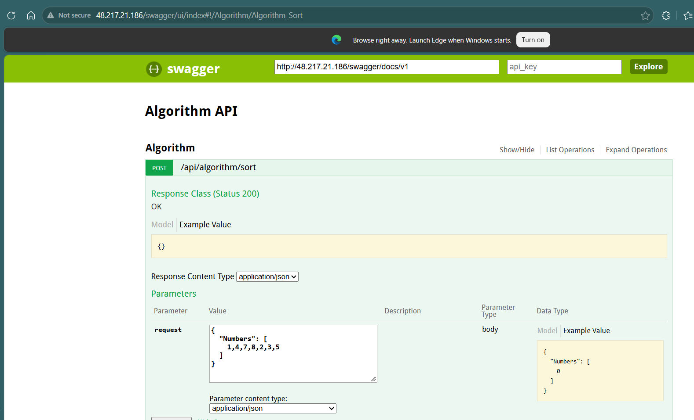

# Algorithm API — Windows Container on AKS



A .NET Framework 4.8 Web API demonstrating basic algorithm implementations, containerized as a **Windows Container** and deployed to **Azure Kubernetes Service (AKS)**.

---

## Tech Stack

| Layer | Technology |
|-------|-----------|
| Framework | .NET Framework 4.8 |
| API | ASP.NET Web API 5.2.9 |
| Swagger | Swashbuckle 5.6.0 |
| Container | Windows Server Core ltsc2022 |
| Registry | Azure Container Registry (ACR) |
| Orchestration | AKS with Windows Node Pool |

---

## Project Structure

```
WindowsContainer/
├── AlgorithmApi/
│   ├── Controllers/
│   │   └── AlgorithmController.cs   # API endpoints
│   ├── Services/
│   │   └── AlgorithmService.cs      # Algorithm logic
│   ├── Models/
│   │   └── SortRequest.cs           # Request models
│   ├── App_Start/
│   │   ├── WebApiConfig.cs          # Route configuration
│   │   └── SwaggerConfig.cs         # Swagger registration
│   └── Dockerfile                   # Multi-stage Windows container build
├── k8s/
│   ├── deployment.yaml              # AKS deployment manifest
│   └── service.yaml                 # LoadBalancer service manifest
├── .dockerignore                    # Excludes .vs, bin, obj from ACR build context
├── .acrignore                       # ACR specific ignores
├── AKS_DEPLOYMENT_GUIDE.md          # Step-by-step AKS deployment guide
└── DEPLOYMENT_GUIDE.md              # Full deployment guide including local Docker
```

---

## API Endpoints

Base URL: `http://<external-ip>`

| Method | Route | Description |
|--------|-------|-------------|
| POST | `/api/algorithm/sort` | Bubble sort an array of integers |
| POST | `/api/algorithm/search` | Binary search for a target in an array |
| GET | `/api/algorithm/palindrome/{word}` | Check if a word is a palindrome |
| GET | `/swagger` | Swagger UI |

### Request & Response Examples

**Sort**
```json
// POST /api/algorithm/sort
// Request
{ "numbers": [5, 3, 1, 4, 2] }

// Response
{ "sorted": [1, 2, 3, 4, 5] }
```

**Search**
```json
// POST /api/algorithm/search
// Request
{ "numbers": [5, 3, 1, 4, 2], "target": 3 }

// Response
{ "index": 2, "found": true }
```

**Palindrome**
```json
// GET /api/algorithm/palindrome/racecar

// Response
{ "word": "racecar", "isPalindrome": true }
```

---

## Dockerfile

Multi-stage build — no local Docker or Visual Studio publish required.  
Stage 1 compiles with the SDK image, Stage 2 copies only the publish output into the lightweight ASP.NET runtime image.

```dockerfile
# escape=`
# Stage 1 - Restore and Build
FROM mcr.microsoft.com/dotnet/framework/sdk:4.8-windowsservercore-ltsc2022 AS build
WORKDIR /src

COPY packages/ ./packages/
COPY AlgorithmApi/ ./AlgorithmApi/

WORKDIR /src/AlgorithmApi
RUN nuget restore AlgorithmApi.csproj -PackagesDirectory ../packages
RUN msbuild AlgorithmApi.csproj `
    /p:Configuration=Release `
    /p:DeployOnBuild=true `
    /p:WebPublishMethod=FileSystem `
    /p:PublishUrl=C:\publish `
    /p:DeleteExistingFiles=True

# Stage 2 - Runtime
FROM mcr.microsoft.com/dotnet/framework/aspnet:4.8-windowsservercore-ltsc2022
WORKDIR /inetpub/wwwroot
COPY --from=build C:\src\AlgorithmApi\obj\Release\Package\PackageTmp .
```

> The `# escape=`` ` directive switches the escape character to backtick so backslashes are treated as Windows path separators.  
> MSBuild ignores `PublishUrl` for Web Application projects and always writes output to `obj\Release\Package\PackageTmp`.

---

## Build & Deploy

### Prerequisites
- Azure CLI (`az --version`)
- kubectl
- An Azure subscription

### 1 — Login to Azure

```powershell
az login
az account set --subscription "<your-subscription-id>"
```

### 2 — Create Resource Group and ACR

```powershell
az group create --name rg-wincontainer-test --location eastus

az acr create `
  --resource-group rg-wincontainer-test `
  --name <your-acr-name> `
  --sku Basic `
  --admin-enabled true

az acr login --name <your-acr-name>
```

### 3 — Build and Push via ACR Build

No Docker Desktop required. Azure CLI zips the source and builds on a Windows ACR agent.

```powershell
# Run from solution root
az acr build `
  --registry <your-acr-name> `
  --image algorithmapi:v1 `
  --platform windows `
  --file AlgorithmApi/Dockerfile `
  .
```

### 4 — Create AKS Cluster with Windows Node Pool

```powershell
# Linux system node pool (required by AKS)
az aks create `
  --resource-group rg-wincontainer-test `
  --name aks-wincontainer-test `
  --node-count 1 `
  --node-vm-size Standard_B2s `
  --network-plugin azure `
  --generate-ssh-keys `
  --attach-acr <your-acr-name> `
  --nodepool-name systempool

# Windows node pool
az aks nodepool add `
  --resource-group rg-wincontainer-test `
  --cluster-name aks-wincontainer-test `
  --os-type Windows `
  --name winnp `
  --node-count 1 `
  --node-vm-size Standard_D2s_v3
```

### 5 — Deploy to AKS

```powershell
az aks get-credentials `
  --resource-group rg-wincontainer-test `
  --name aks-wincontainer-test

kubectl apply -f k8s/deployment.yaml
kubectl apply -f k8s/service.yaml

# Watch pods (Windows containers take 5-10 mins on first pull)
kubectl get pods -w
```

### 6 — Test

```powershell
$ip = kubectl get svc algorithmapi-svc -o jsonpath='{.status.loadBalancer.ingress[0].ip}'

start "http://$ip/swagger"
curl http://$ip/api/algorithm/palindrome/racecar
```

### 7 — Redeploy After Code Changes

```powershell
az acr build `
  --registry <your-acr-name> `
  --image algorithmapi:v2 `
  --platform windows `
  --file AlgorithmApi/Dockerfile `
  .

kubectl set image deployment/algorithmapi algorithmapi=<your-acr-name>.azurecr.io/algorithmapi:v2
kubectl rollout status deployment/algorithmapi
```

---

## Cost Control

```powershell
# Stop cluster when not testing (saves ~$0.14/hr)
az aks stop --name aks-wincontainer-test --resource-group rg-wincontainer-test

# Resume
az aks start --name aks-wincontainer-test --resource-group rg-wincontainer-test

# Full cleanup
az group delete --name rg-wincontainer-test --yes --no-wait
```

---

## Troubleshooting

### 1 — `bad escape \e at position 11` during `az acr build`

Backslashes in the Dockerfile are interpreted as escape characters by the tar packager.

**Fix:** Add `# escape=`` ` as the first line of the Dockerfile and use forward slashes or backtick-escaped paths.

---

### 2 — `[Errno 13] Permission denied` on `.vs` folder during `az acr build`

Visual Studio locks files inside `.vs/FileContentIndex/*.vsidx` and `.vs/CopilotIndices/*.db`.  
The Azure CLI tar packager fails when it tries to read them.

**Fix:** The `.dockerignore` at the solution root excludes these:
```
**/.vs/**
**/*.vsidx
**/*.db
**/*.db-shm
**/*.db-wal
```
> Note: `az acr build` reads `.dockerignore`, **not** `.acrignore`.

---

### 3 — `COPY failed: stat C:\publish: file does not exist`

MSBuild ignores the `PublishUrl` property for Web Application (`.csproj`) projects when using `DeployOnBuild=true`. It always writes output to `obj\Release\Package\PackageTmp` regardless of what `PublishUrl` is set to.

**Fix:** The `COPY` in Stage 2 points to the actual output path:
```dockerfile
COPY --from=build C:\src\AlgorithmApi\obj\Release\Package\PackageTmp .
```

---

### 4 — `dir C:\ /b` fails in Dockerfile `RUN` step

The ACR build agent wraps all `RUN` commands in `powershell -Command`. The `dir` command with `/b` flag is a `cmd.exe` syntax that PowerShell's `Get-ChildItem` alias does not support.

**Fix:** Use native PowerShell commands in `RUN` steps:
```dockerfile
RUN Get-ChildItem -Path C:\src -Recurse -Directory | Select-Object -ExpandProperty FullName
RUN if (Test-Path C:\publish) { Get-ChildItem C:\publish -Recurse } else { Write-Host 'NOT FOUND' }
```

---

### 5 — `The container operating system does not match the host operating system`

The Windows container base image OS version must exactly match the Windows node pool OS version. Using `ltsc2019` image on a Windows Server 2022 node (or vice versa) causes this error.

**Fix:** Check the node OS version and match the Dockerfile base image tag:
```powershell
kubectl get node <node-name> -o jsonpath="{.status.nodeInfo.osImage}"
```

| Node OS | Dockerfile base image tag |
|---------|--------------------------|
| Windows Server 2019 | `ltsc2019` |
| Windows Server 2022 | `ltsc2022` |

This project uses `ltsc2022` to match the default AKS Windows node pool OS.

---

### 6 — Assembly binding errors after adding Swashbuckle

Swashbuckle 5.6.0 was compiled against older versions of `System.Web.Http` and `Microsoft.Web.Infrastructure`. Binding redirects are required in `Web.config`.

**Fix:** Add these to the `<assemblyBinding>` section in `Web.config`:
```xml
<dependentAssembly>
  <assemblyIdentity name="System.Web.Http" publicKeyToken="31bf3856ad364e35" culture="neutral" />
  <bindingRedirect oldVersion="0.0.0.0-5.2.9.0" newVersion="5.2.9.0" />
</dependentAssembly>
<dependentAssembly>
  <assemblyIdentity name="System.Net.Http.Formatting" publicKeyToken="31bf3856ad364e35" culture="neutral" />
  <bindingRedirect oldVersion="0.0.0.0-5.2.9.0" newVersion="5.2.9.0" />
</dependentAssembly>
<dependentAssembly>
  <assemblyIdentity name="Microsoft.Web.Infrastructure" publicKeyToken="31bf3856ad364e35" />
  <bindingRedirect oldVersion="0.0.0.0-1.0.0.0" newVersion="1.0.0.0" />
</dependentAssembly>
```

---

### 7 — Pod stuck in `ContainerCreating` for a long time

Windows container images are large (~3–5 GB). On first deployment the node must pull the entire image.

**Fix:** Just wait. Monitor pull progress:
```powershell
kubectl describe pod <pod-name>
# Look at Events section for "Pulling image" progress
```

---

### 8 — `ImagePullBackOff`

ACR is not attached to the AKS cluster or the attachment has expired.

**Fix:**
```powershell
az aks update `
  --name aks-wincontainer-test `
  --resource-group rg-wincontainer-test `
  --attach-acr <your-acr-name>
```

---

### 9 — Pod in `Pending` state — no nodes available

The Windows node pool may have been scaled to 0.

**Fix:**
```powershell
az aks nodepool scale `
  --resource-group rg-wincontainer-test `
  --cluster-name aks-wincontainer-test `
  --name winnp `
  --node-count 1
```
